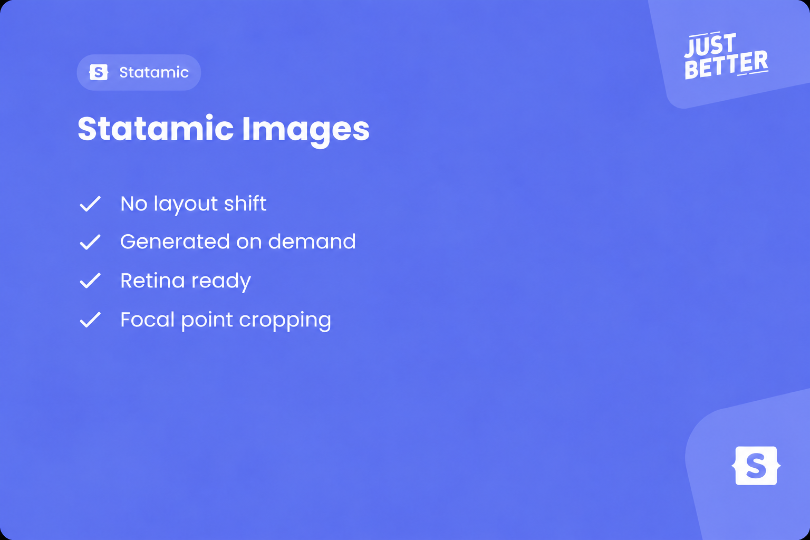

<a href="https://github.com/justbetter/statamic-images" title="Statamic Images">
    
</a>

# Statamic Images

<p>
    <a href="https://github.com/justbetter/statamic-images"></a>
    <a href="https://github.com/justbetter/statamic-images"></a>
    <a href="https://github.com/justbetter/statamic-images"></a>
    <a href="https://github.com/justbetter/statamic-images"></a>
</p>

Responsive `<picture>` elements for Statamic assets, generated with Glide. Each image gets a `<source>` per configured format, and each dimension gets a 1x and a 2x candidate, up to the configured `max_size`.

## Requirements

- PHP 8.4
- Laravel 13
- Statamic 6

## Installation

Install the composer package.

```bash
composer require justbetter/statamic-images
```

## Setup

Publish the configuration of the package.

```bash
php artisan vendor:publish --provider="JustBetter\StatamicImages\ServiceProvider" --tag=config
```

### Statamic asset configuration

This addon relies on two settings in `config/statamic/assets.php`:

```php
'image_manipulation' => [
    'route' => 'img',

    'cache' => 'hybrid',
    'cache_path' => public_path('img'),

    // ...
],

'auto_crop' => true,
```

**Hybrid caching.** A single image renders up to two URLs per dimension per format, so one page can easily ask Glide for dozens of images. With `'cache' => 'hybrid'`, the Glide tag only works out the URL where each image will live and returns it, without generating anything. Page rendering stays fast. The first browser request for an image falls through to PHP, which generates and stores the file. From then on, the web server serves it as a static file. Candidates the browser never picks are never generated.

The `cache_path` must be the public directory that matches the `route`. With `route` set to `img`, that is `public_path('img')`. If the two don't line up, every image keeps going through PHP and Statamic logs a warning.

Hybrid URLs depend on Glide's path cache, so keep that cache store shared between servers and don't clear it on deploy. Running `php artisan statamic:glide:clear` changes the generated URLs, so clear your static cache afterwards. See [Caching](https://statamic.dev/image-manipulation#caching) in the Statamic docs for the trade-offs between the caching strategies.

**Auto crop.** When a dimension has both a width and a height, the image has to be cropped. With `auto_crop` enabled, Glide crops around the focal point editors set on the asset, or the center when none is set. Without it, a fixed-ratio dimension does not crop around the focal point.

## Configuration

`config/statamic-glide-images.php`:

| Key | Default | Description |
|---|---|---|
| `max_size` | `2560` | Maximum width and height in pixels of a generated image. Candidates that would be larger are skipped. |
| `formats` | `webp` | Glide format => mime type. Each format becomes a `<source>`, in this order. The last format is used for the fallback ``. |

`avif` and `jpg` are included in the config, commented out. To serve AVIF, your image driver must support it.

## Usage

```blade
<x-justbetter::image
    :image="$entry->image"
    :dimensions="[['w' => 460, 'h' => 350]]"
    sizes="(max-width: 999px) 100vw, 460px"
    class="size-full object-cover"
/>
```

| Prop | Type | Default | Description |
|---|---|---|---|
| `image` | `Statamic\Assets\Asset` | required | The asset to render. |
| `dimensions` | `array` | `[['w' => 960]]` | The sizes to generate, see below. |
| `sizes` | `string` | `auto, 100vw` | The `sizes` attribute on each `<source>`. |
| `quality` | `int` | `90` | Glide quality. |

### Dimensions

Each dimension has a `w`, an `h`, or both:

- **Only `w` or only `h`:** the other side follows from the asset's aspect ratio.
- **Both:** the image is cropped to that size, around the focal point when `auto_crop` is enabled.

Each dimension produces two candidates, 1x and 2x, using Glide's `dpr` parameter. A candidate whose width or height would be larger than `max_size` is skipped.

Several dimensions, for example a card that is 460px wide on small screens and 390px from 1000px up:

```blade
<x-justbetter::image
    :image="$tile['image']"
    :dimensions="[
        ['w' => 390, 'h' => 475],
        ['w' => 460, 'h' => 350],
    ]"
    sizes="(max-width: 999px) 460px, 390px"
/>
```

This produces the candidates `390w`, `780w`, `460w` and `920w`. All dimensions end up in the same `srcset` per format, and the browser picks a candidate by the width it needs. When dimensions have different aspect ratios, which crop is shown depends on that width, not on the breakpoint.

### Attributes

Any other attribute is passed to the ``. `class` is added to the classes. Other attributes override the defaults, for example for an image above the fold:

```blade
<x-justbetter::image :image="$hero" loading="eager" fetchpriority="high" />
```

### Output

```html
<picture>
    <source type="image/webp" srcset="/img/…/image.webp 460w, /img/…/image.webp 920w" sizes="…">
    
</picture>
```

The fallback `` uses the 1x candidate of the last dimension in the last configured format. Its `width` and `height` match that candidate. `alt` comes from the asset's `alt` field.

### SVG and GIF

SVG and GIF assets are not processed by Glide. They render as a single `` of the original file, with the attributes passed through.

## Using the action directly

The component uses the `BuildsPicture` action. You can call it yourself, for example in an Antlers tag or an API response:

```php
use JustBetter\StatamicImages\Contracts\BuildsPicture;
use JustBetter\StatamicImages\Data\Config;

$picture = app(BuildsPicture::class)->build($asset, Config::new([
    'dimensions' => [['w' => 460, 'h' => 350]],
    'params' => ['quality' => 80],
]));

$picture->sources; // ['image/webp' => '… 460w, … 920w']
$picture->src;
$picture->width;
$picture->height;
```

`params` holds extra Glide parameters, which are added to every URL. They are applied last, so they override the generated `width`, `height` and `format`. `Config::new()` validates that `dimensions` is set and defaults `params` to an empty array.

## Extending

To change how a picture is built, bind your own implementation of the contract in a service provider:

```php
use JustBetter\StatamicImages\Contracts\BuildsPicture;

$this->app->singleton(BuildsPicture::class, MyBuildPicture::class);
```

## Quality

To ensure the quality of this package, run the following command:

```bash
composer quality
```

This will execute five tasks:

1. Checks if the code is correctly formatted
2. Checks for any issues using static code analysis
3. Makes sure all tests are passed
4. Makes sure the code coverage is 100%
5. Checks for possible refactors with Rector

## Contributing

Please see [CONTRIBUTING](.github/CONTRIBUTING.md) for details.

## Security Vulnerabilities

Please review [our security policy](../../security/policy) on how to report security vulnerabilities.

## Credits

- [Bob Wezelman](https://github.com/BobWez98)
- [All Contributors](../../contributors)

## License

The MIT License (MIT). Please see [License File](LICENSE) for more information.

<a href="https://justbetter.nl" title="JustBetter">
    
</a>
